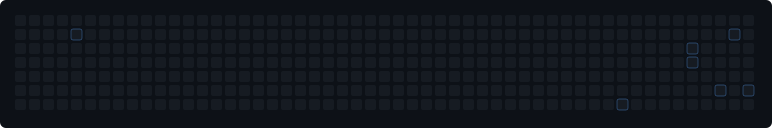

# GitHub Quantum Wave Scattering

### A journey through code, contributions, and quantum physics.

This project explores the intersection of computational physics and software development by transforming GitHub contribution activity into a two-dimensional quantum scattering simulation.

Each day in the GitHub contribution calendar is mapped onto a spatial grid, where the number of contributions determines the strength of a localized scattering potential. Public and private contributions, including commits, issues, pull requests, and other recognized activities, contribute to the resulting landscape.

### The Physics Behind the Project

The scattering problem is formulated using Green's functions and a multiple-scattering approach, drawing on the **Boundary Wall Method (BWM)**.

The method provides a framework for investigating quantum scattering problems through boundary interactions and Green-function techniques. In this project, the contribution calendar defines a discrete distribution of scattering centers, whose interaction with an incident plane wave is obtained by solving a complex linear system.

The local scattering strength is defined as

\[
\gamma_j = \alpha C_j,
\]

where \(C_j\) is the number of contributions on a given day and \(\alpha\) is a scaling parameter.

The resulting wave field incorporates the incident wave and the contributions from all scattering centers, revealing the interference patterns generated by the underlying contribution landscape.

### Numerical Approach

The simulation employs:

- Two-dimensional free-space Green's functions.
- Complex-valued matrices and linear algebra.
- Multiple-scattering interactions.
- Gaussian elimination with partial pivoting.
- Time-dependent visualization of the resulting wave field.

### Automated GitHub Integration

GitHub Actions periodically retrieves the contribution calendar through the GitHub GraphQL API, updates the numerical input data, compiles the C++ simulation, and generates an animated SVG.

The result is a continuously evolving representation of software development through the mathematical language of quantum scattering.

**Every contribution leaves a mark. Every mark becomes a scattering center. Every scattering center contributes to the wave.**

---

*Inspired by the Boundary Wall Method (BWM) and its applications to quantum scattering theory.*
